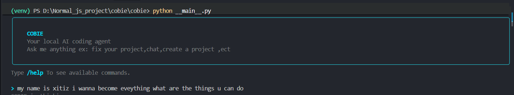
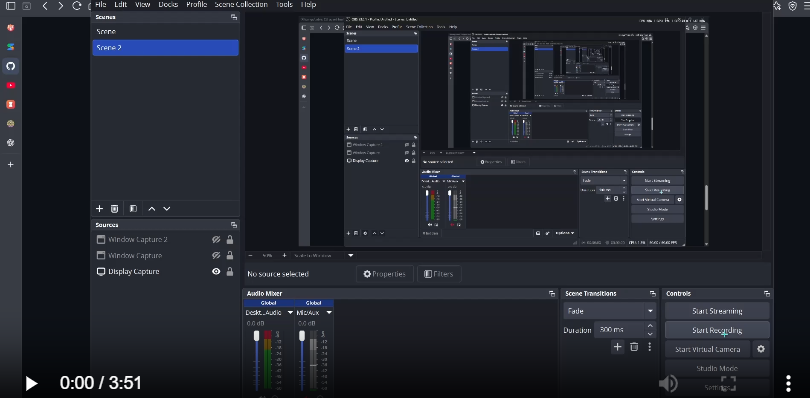
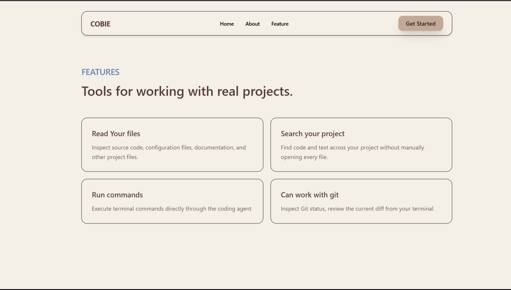
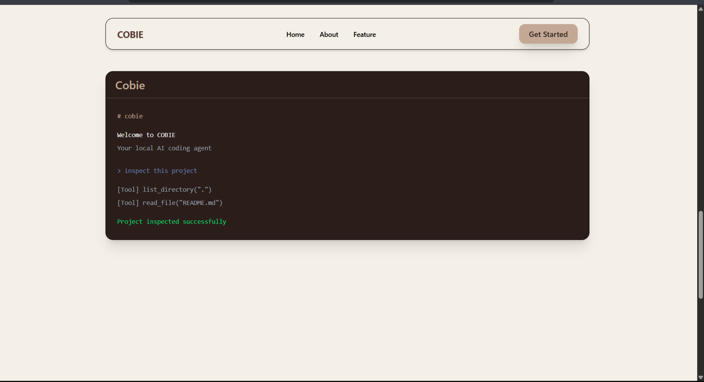
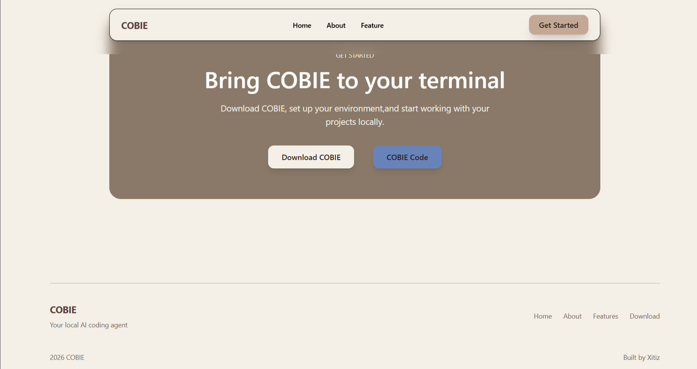

    # What is COBIE
 
> COBIE is your little helper that live on your computer.

Think of COBIE as a helper that helps u while u work on your project.you can tell it what u want to do and it will help u with it like find,create,and change files.(only work for file/document)



U know every machine have an engine for them to work just like that COBIE's engine is google gemini api.U don't need to understand every part of engine for to use machine but just in case.

## API 
> What is an API ? 
Think of api like a bridge that connect your bakery to your customer. 
ur customer cannot order cookies without going to bakery but api aka bridge allow u to take ur order and give it to bakery using bridge 
 
 u can also connect ur bakery to ur customer using bridge from this website.*https://aistudio.google.com/api-keys *

## Feature(What are the things cobie can do )

- u don't need to ask any one for the if the things u wrote in a file is correct u can just correct it or ask cobie for it in ur own computer
- Can read file in ur computer for u and give answer.
- CAn write something for u or anything just need u to ask 
- or u can use it to change ur shilly mistake in ur existing file (don't worry mistake can happen  )

# Tech Stack(What are the things i used to make cobie)

- python ()
- Rich for terminal ui
- google gemini api key
- python subprocess module


# How COBIE work

Okii enough of cobie can do that and blah balh but how does cobie actually work.
Let's understand this through a story.(hehe i know u like story grandma)

Suppose you are siting at your desk and say :

"COBIE make me a document a website or create a file which has i love cookie 1000 time"

What do u think happen next ?

COBIE will get ur instruction like a u telling a person or ur grandson what u want them to do.Then COBIE also asked his helper to do ur work(the helper is google gemini api) and then inside COBIE there is a manager who decide what to do with gemini (COBIE helper) and after deciding COBIE workers do simple specific task like create document read and edit after all the effort from these helper COBIE finally give u the result.

In Simple -> you give work -> cobie understands it -> the manager decides what to do -> the workers do the job -> COBIE shows the result

# Project FOlder(different parts of cobie and it's worker).

## agent(The brain/manager of COBIE)

think of it as the manager of shop .
The manager handle the communation ,listen what needs to be done and decides which worker should handle the job.

## tools(The workers)
These are the parts that actually carry out the work.
As in a shop there are different worker just like that cobie has different worker for different task.
- one worker finds documents/file.
- one worker read documents/file.
- one worker change documents/file.

## Cli(the place where u talk to cobie)
This is the part you see when u open cobie and start typing

think of this as a reception desk of an office. u just tell receptionist what u need and she/he will brings the information to right people and u get ur job or information from them

# The website 

I also created a website for COBIE.
A website is just like shop but online where u can buy ,sell or even roam,etc 

The purpose of making website is to showcase our COBIE..



Feature







# For website Tech Stack

- React
- Typescript
- Tailwind


# How to run Cobie.
There are two ways to run COBIE
- Download COBIE package from pip(store from where u will get cobie but its free) install using:
```bash
pip install cobie
```
- then to activate COBIE just type cobie in terminal(the place where u can type command for cobie) :
```bash
cobie
```
- After that just add google geminai free version code and run (the gemini model should be gemini-3-flash-preview)

- Second run locally by installing cobie source code 


# Installation

## Requirements

- python must be install
- A google gemini api key

### 1. Clone the repository

```bash
    git clone https://github.com/XItizmgr/cobie
    cd cobie
```

### 2. Create a virtual enrironment

```bash
    python -m venv venv
    venv\Scripts\activate
```

### 3. Install dependencies

```bash
    pip install -r requirements.txt
```

### 4. Get a gemini API key

COBIE use google gemini api as its llm model
u can get it from here(make sure to get the free gemini-3-flash-preview version api key)
*https://aistudio.google.com/apikey*

### 5. Run COBIE

```bash
    python __main__.py
```

# How to run COBIE.

- Download COBIE (Folder for now ) from the website .
- open the folder
- and navigate to cobie main folder u have two folder inside the root folder frontend and cobie navigate to cobie 
```bash
    cd cobie
```

- Create a virtual enrironment

```bash
    python -m venv venv
    venv\Scripts\activate
```

- Install dependencies

```bash
    pip install -r requirements.txt
```

- Get a gemini API key
  COBIE use google gemini api as its llm model
  u can get it from here
  *https://aistudio.google.com/apikey*

- Run COBIE

```bash
    python __main__.py
```

# Reminder

The project is not fully complete as i want to make COBIE a vs code extension which can help many devloper and it will have many future plan..
and TwT your credit/token will be used so fast so worry about that TwT

